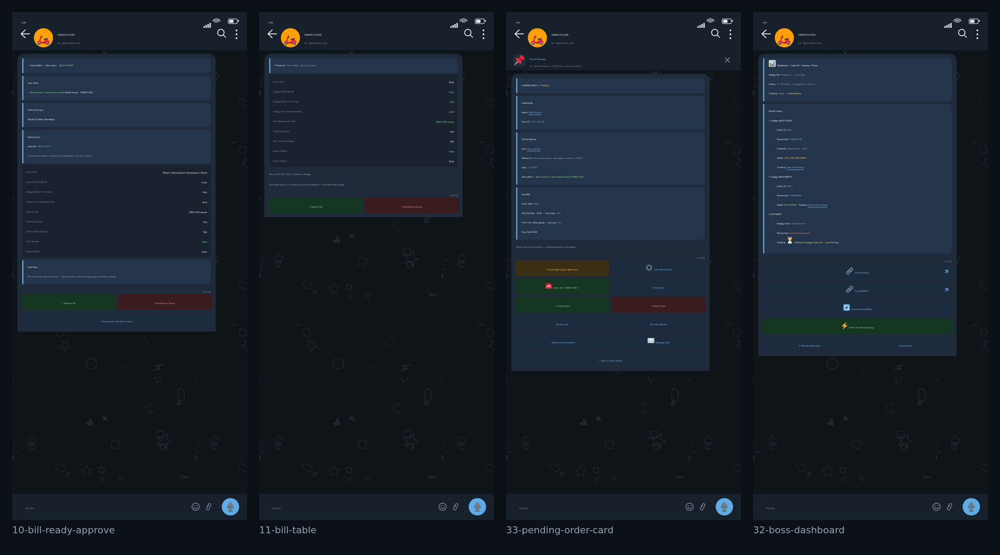

# mockup — Ammi Abbu Ka Sacha Beta (Telegram Swiggy bot) UI mockups

**70 pixel-perfect Telegram screens** for the bot, one per scenario — what the user/Boss actually sees
and which SMS lands on the parents' phone. **No mini app, no WebApp:** everything is a plain Telegram
message + inline keyboard + `force_reply` prompt, exactly like the real bot.

- `images/` → 70 PNGs, 1080×2340 (Android Telegram, dark; one light-theme variant)
- `contact-sheets/` → 6 review sheets (12 screens per sheet) for quick scanning
- `render/` → the canvas renderer that generated them (no browser, no screenshot tooling)
- `SCENARIOS.md` → plain list of all 70 scenarios

Copy was lifted from the real bot source, not invented: `index.js`, `boss-panel.js`, `rich-text.js`,
`sms-notify.js`, `order-tracking.js`, `forwarded-order-flow.js` of
`hulm0408/ammi-abbu-ka-sacha-beta`. All numbers/names/amounts are **fictional demo data**
(order `#4821` = evening biryani, ₹534 · order `#4817` = morning thandai + aloo paratha, ₹174).

## Quick look



## Scenarios (70)

### Group A — customer order flow (01–21)
Cart/address link intake, single-card UX, force-reply prompts, missing/expired address link, empty-cart
block, recipient-number rule, max-coupon bill lock, approve → QR → payment verify, order confirmed with
live status + OTP, delivered receipt, honest "tracking link nahi mila" card, cancel confirm, orders done,
duplicate-order alert.

### Group B — Boss panel (22–36)
Boss home, login with number, OTP sent / wrong OTP / Swiggy security challenge + rate limit, session-JSON
import, login-success card with auto offer claim, claim partial-failure retry, family accounts, switch
active Order Hub, dashboard (id + phone + tracking), pending order card with account/coupon pickers,
auto max-coupon live scan, export & logout checklist, Swiggy-side account delete.

### Group C — phone-level + app-level (37–48)
SMS OTP banner over Telegram, real SMS to parents (order placed / payment required), OTP autofill chips,
personalised UPI QR sheet, Swiggy "rider at your door" screen, wallet & free-cash auto-lock, cancelled
list, bill-rejected rework, light theme, bulk session-JSON vault, unauthorized tap.

### Group D — customer premium flow (49–58) and Group E — Boss advanced (59–70)
Slot reserve, bill re-approve history, payment screenshot verify, live tracking with map, OTP share to
family group, delivered + parent reply, late-delivery apology + refund, coupon switch, 1-tap re-order,
payment poll alert, JSON export + expiry warning, logout-all with active-order block, vault export done,
free-cash results, auto-poller log, anti-bot cooldown, address picker, coupon probe, slot management,
refund tracking, "no eligible offer → bill not sent".

### Customer — order flow

| # | Image | Scenario |
|---|---|---|
| 1 | [](images/01-customer-welcome.png) `01-customer-welcome.png` | Customer /start → welcome + live status card |
| 2 | [](images/02-cart-accepted.png) `02-cart-accepted.png` | Cart link paste → prompt delete + card updates |
| 3 | [](images/03-force-reply-cart.png) `03-force-reply-cart.png` | Force-reply prompt: input focused with placeholder |
| 4 | [](images/04-duplicate-order-alert.png) `04-duplicate-order-alert.png` | Second order attempt while one is active + toast |
| 5 | [](images/05-address-unresolved.png) `05-address-unresolved.png` | Address link expired → asks for fresh link/pin |
| 6 | [](images/06-missing-cart-only.png) `06-missing-cart-only.png` | Send to Beta with missing data → only asks for the missing link |
| 7 | [](images/07-empty-cart-block.png) `07-empty-cart-block.png` | Tracking link pasted as cart → ₹0 empty order blocked |
| 8 | [](images/08-recipient-mobile-required.png) `08-recipient-mobile-required.png` | Recipient 10-digit number required (force reply) |
| 9 | [](images/09-scan-progress.png) `09-scan-progress.png` | Send to Beta → best account scan in progress |
| 10 | [](images/10-bill-ready-approve.png) `10-bill-ready-approve.png` | Max-discount bill locked → Approve / Something is wrong |
| 11 | [](images/11-bill-table.png) `11-bill-table.png` | Bill summary as readable rows (coupon + free cash + free delivery) |
| 12 | [](images/12-payment-processing.png) `12-payment-processing.png` | QR not ready yet → honest processing card (no fake QR) |
| 13 | [](images/13-order-confirmed.png) `13-order-confirmed.png` | Order confirmed: live status + OTP + tracking |
| 14 | [](images/14-order-done-receipt.png) `14-order-done-receipt.png` | Order done: receipt + rider + delivered tracking |
| 15 | [](images/15-no-tracking-yet.png) `15-no-tracking-yet.png` | Swiggy link not published yet → auto-fetch promise |
| 16 | [](images/16-extract-prompt.png) `16-extract-prompt.png` | Extract Tracking Link → order id maangta hai |
| 17 | [](images/17-extract-found.png) `17-extract-found.png` | Extract success: id + phone + live tracking + OTP + rider |
| 18 | [](images/18-extract-not-found.png) `18-extract-not-found.png` | Extract fail: id kisi ID par nahi mila (no fake link) |
| 19 | [](images/19-orders-done.png) `19-orders-done.png` | Orders Done — successful order history |
| 20 | [](images/20-cancel-confirm.png) `20-cancel-confirm.png` | Cancel order confirmation (popup style) |
| 21 | [](images/21-payment-pending-toast.png) `21-payment-pending-toast.png` | Check payment status → alert: payment nahi mila |

### Boss panel — login, accounts, offers, dashboard

| # | Image | Scenario |
|---|---|---|
| 22 | [](images/22-boss-panel-home.png) `22-boss-panel-home.png` | Boss Panel home — accounts + order counters |
| 23 | [](images/23-boss-login-number.png) `23-boss-login-number.png` | Boss: Login with Number → force reply for phone |
| 24 | [](images/24-otp-sent-card.png) `24-otp-sent-card.png` | OTP sent card (login flow) with resend/copy |
| 25 | [](images/25-otp-wrong-attempt.png) `25-otp-wrong-attempt.png` | Wrong OTP → alert + resend timer |
| 26 | [](images/26-otp-error-security.png) `26-otp-error-security.png` | OTP request failed — security challenge / rate limit |
| 27 | [](images/27-json-import-preview.png) `27-json-import-preview.png` | Session JSON paste → parsed preview (tid/deviceId/sid) |
| 28 | [](images/28-login-success-offers.png) `28-login-success-offers.png` | Login success + auto offer claim (Swiggy-style session card) |
| 29 | [](images/29-claim-partial-fail.png) `29-claim-partial-fail.png` | Claim ₹50 offers → partial failure with retry |
| 30 | [](images/30-family-accounts.png) `30-family-accounts.png` | Connected accounts list with statuses |
| 31 | [](images/31-switch-active-account.png) `31-switch-active-account.png` | Order account switched → both chats informed |
| 32 | [](images/32-boss-dashboard.png) `32-boss-dashboard.png` | Dashboard — order id, phone, tracking per order |
| 33 | [](images/33-pending-order-card.png) `33-pending-order-card.png` | Boss pending order card — account pick + accept/reject |
| 34 | [](images/34-auto-coupon-scan.png) `34-auto-coupon-scan.png` | Auto Max Coupon (Best Account) — live scan |
| 35 | [](images/35-export-logout-picker.png) `35-export-logout-picker.png` | Export & Logout (1+ Orders) — checklist with toggles |
| 36 | [](images/36-swiggy-delete-otp.png) `36-swiggy-delete-otp.png` | Delete account from Swiggy — 2-step danger with OTP |

### SMS / payment sheet / app-level / edge cases

| # | Image | Scenario |
|---|---|---|
| 37 | [](images/37-otp-sms-phone.png) `37-otp-sms-phone.png` | Phone home: Swiggy SMS OTP banner over Telegram chat |
| 38 | [](images/38-order-placed-sms.png) `38-order-placed-sms.png` | Parent ke phone par order-placed SMS |
| 39 | [](images/39-payment-sms.png) `39-payment-sms.png` | Payment-required SMS (short link + amount) |
| 40 | [](images/40-otp-autofill.png) `40-otp-autofill.png` | OTP autofill chips above keyboard |
| 41 | [](images/41-payment-sheet-mock.png) `41-payment-sheet-mock.png` | Customer ka screen: QR payment sheet (personalised UPI QR) |
| 42 | [](images/42-swiggy-app-otp.png) `42-swiggy-app-otp.png` | Swiggy app screen jaisa: rider aaya, delivery OTP |
| 43 | [](images/43-wallet-and-refer.png) `43-wallet-and-refer.png` | Wallet and refer — free cash + referral progress |
| 44 | [](images/44-cancelled-list.png) `44-cancelled-list.png` | Cancelled / rejected orders list (honest empty state) |
| 45 | [](images/45-rejected-bill.png) `45-rejected-bill.png` | Bill galat laga → customer ne "! Something is wrong" dabaya |
| 46 | [](images/46-final-card-light.png) `46-final-card-light.png` | Same order card — Telegram LIGHT theme |
| 47 | [](images/47-bulk-json-vault.png) `47-bulk-json-vault.png` | Bulk Login — 8 session JSON files ek saath import |
| 48 | [](images/48-unauthorized-lock.png) `48-unauthorized-lock.png` | Random user ne Boss button dabaya → unauthorized |

### Customer — premium flow (thandai + aloo paratha, subah 7 AM)

| # | Image | Scenario |
|---|---|---|
| 49 | [](images/49-customer-cart-received.png) `49-customer-cart-received.png` | Customer → Beta: cart + address mil gaya, slot reserved |
| 50 | [](images/50-customer-bill-approved.png) `50-customer-bill-approved.png` | Customer → Beta: bill galat tha, dobara banwaya, ab approve |
| 51 | [](images/51-customer-qr-paid.png) `51-customer-qr-paid.png` | Customer → Beta: maine QR se pay kar diya |
| 52 | [](images/52-customer-live-tracking.png) `52-customer-live-tracking.png` | Customer → Beta: live tracking puchha |
| 53 | [](images/53-customer-delivery-otp.png) `53-customer-delivery-otp.png` | Customer → Beta: OTP chahiye (rider gate me) |
| 54 | [](images/54-customer-share-otp.png) `54-customer-share-otp.png` | OTP share-to-group: Beta ne Ammi ke group me bhej diya |
| 55 | [](images/55-customer-delivered.png) `55-customer-delivered.png` | Order delivered — receipt + parent ko thank-you |
| 56 | [](images/56-customer-late-night-fallback.png) `56-customer-late-night-fallback.png` | Customer → Beta: order galat pahuncha, Beta ne galti maani |
| 57 | [](images/57-customer-coupon-picked.png) `57-customer-coupon-picked.png` | Customer ne coupon badalwaaya (Sir se pehle) |
| 58 | [](images/58-customer-reorder.png) `58-customer-reorder.png` | Same order kal phir se — re-order in 1 tap |

### Boss — advanced flows (export, logout, coupons, slots, refund)

| # | Image | Scenario |
|---|---|---|
| 59 | [](images/59-boss-check-payment.png) `59-boss-check-payment.png` | Boss: Check payment → Swiggy verify poll (alert) |
| 60 | [](images/60-boss-export-json-file.png) `60-boss-export-json-file.png` | Boss: Export Session JSON — file + expiry warning |
| 61 | [](images/61-logout-all-confirm.png) `61-logout-all-confirm.png` | Boss: LOGOUT ALL — danger confirm + active order block |
| 62 | [](images/62-export-done-vault.png) `62-export-done-vault.png` | Boss: export + logout ho gaya — vault me 5 files |
| 63 | [](images/63-free-cash-results.png) `63-free-cash-results.png` | Boss: Free Cash claim engine — per account result |
| 64 | [](images/64-auto-poller-log.png) `64-auto-poller-log.png` | Boss: auto tracking poller — background log card |
| 65 | [](images/65-antibot-block.png) `65-antibot-block.png` | Boss: Swiggy ne block kiya — bot ne brute force roka |
| 66 | [](images/66-account-address-picker.png) `66-account-address-picker.png` | Boss: ⌖ Select Account Address — recipient override |
| 67 | [](images/67-coupon-picker.png) `67-coupon-picker.png` | Boss: # Change Coupon — live coupon probe per account |
| 68 | [](images/68-slot-management.png) `68-slot-management.png` | Boss: Slot management — limit + reason + lock |
| 69 | [](images/69-refund-tracking.png) `69-refund-tracking.png` | Boss: refund track — customer ko status, Swiggy pe depend |
| 70 | [](images/70-boss-no-offer-found.png) `70-boss-no-offer-found.png` | Boss: offer nahi mila → pending rakha, customer ko bil nahi bheja |


## Regenerating / editing the mockups

```bash
cd render
npm install          # @napi-rs/canvas + twemoji-svg + resvg + qrcode
node run.js          # renders all scenarios into ../images
node run.js scn_01_customer scn_06_boss_advanced   # or just some groups
node montage.js 01-customer-welcome.png 13-order-confirmed.png   # contact sheet
```

Requires DejaVu fonts for `₹ ✓ ⌖ ▪` glyphs (Linux: `apt install fonts-dejavu-core`).
Scenario definitions live in `render/scn_*.js` — each entry is one image (data, not markup).

## Honest note

These are **rendered mockups, not real Telegram screenshots** — they are meant as the design/spec
target for the bot. Telegram's own chrome (status bar, wallpaper, bubbles, keycaps) is recreated
in `render/lib.js`.
